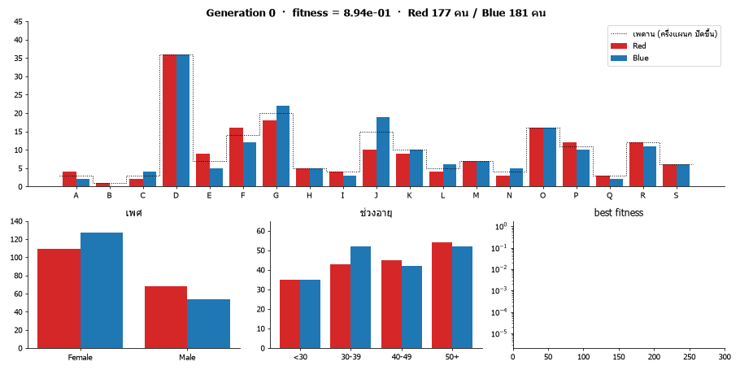
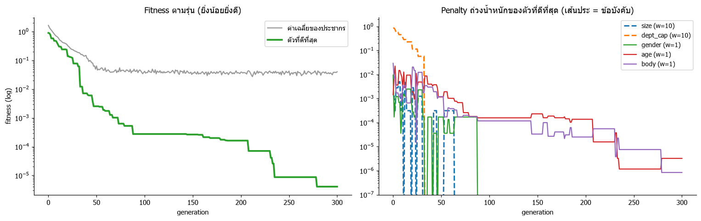
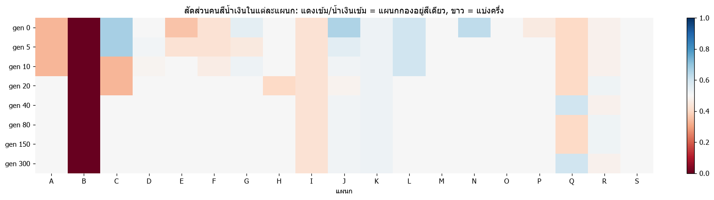
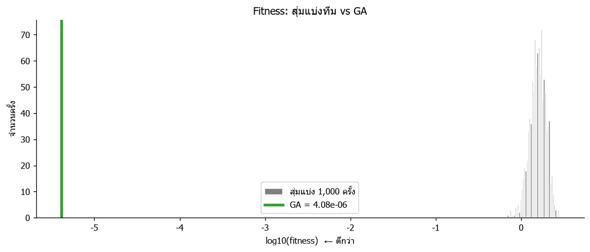
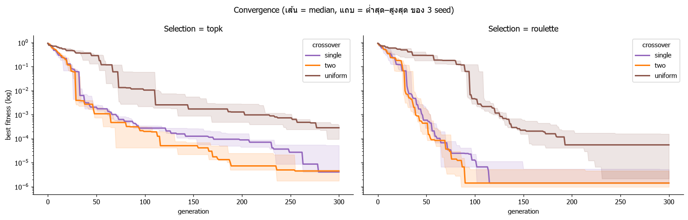
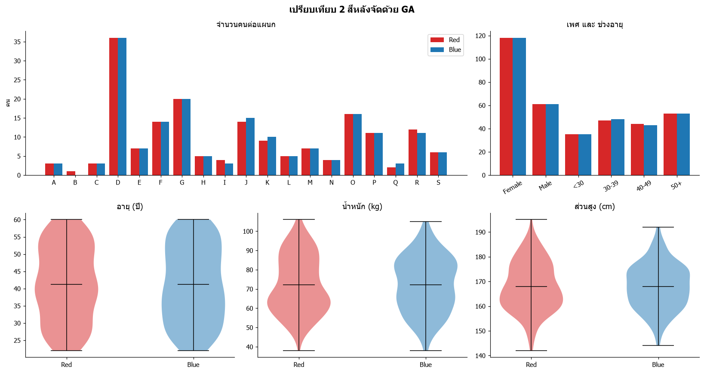

# จัดทีมกีฬาสีด้วย Genetic Algorithm (GA)
### Fair & Cross-Department Sports Day Teams with a Genetic Algorithm

> **English summary** — This project uses a Genetic Algorithm, implemented from scratch with NumPy, to split 358 employees (`HR.csv`: gender, department, weight, height, age) into two sports-day teams. It has two **hard constraints**: equal team size, and no department over-represented in either team, which spreads every department across both colours. It also has three **fairness objectives**: gender balance, age distribution, and average body build. Constraints are weighted 10× in the fitness function (penalty method). The GA first satisfies the constraints and then fine-tunes fairness, reaching a fitness of 4.08 × 10⁻⁶. None of 1,000 random splits satisfied the department constraint. Experiments across 3 seeds found roulette-wheel selection with two-point crossover the strongest combination, and uniform crossover the weakest.



---

## 1. ที่มาและโจทย์
งานนี้เป็นการบ้านวิชา **Machine Learning บทที่ 07 Genetic Algorithms** อาจารย์ให้ข้อมูลพนักงาน `HR.csv` มา 358 คน แต่ละคนมี เพศ, แผนก (19 แผนก), น้ำหนัก, ส่วนสูง และอายุ โจทย์คือใช้ GA แบ่งพนักงานเป็น **2 สี** สำหรับงานกีฬาสี โดย

1. **ยุติธรรม (Fairness)**: สองสีแข่งกันได้สูสี
2. **สานสัมพันธ์ข้ามแผนก (Harmonize)**: พนักงานได้ร่วมทีมกับคนต่างแผนก
3. แสดง **กระบวนการวิวัฒนาการ** ด้วย visualization และส่งโค้ดผ่าน GitHub

**ทีม Finoria**
| ชื่อ | รหัสนักศึกษา |
|---|---|
| อัมพร ชินพร |6752300241 |
| กัลยรัตน์ โพธิสาร |6752301085 |
| ปฏิมา ถิ่นสำราญ | 6752300461 |
| รุจิรัตน์ แสงชัย | 6752300739 |
| นัทธนัท นุ่มนวล | 6752301123 |
| ขวัญมนัส คล้ายมี | 6752301239 |

## 2. ทำไมใช้ Genetic Algorithm
การแบ่ง 358 คนเป็น 2 สีทำได้ $2^{358}$ แบบ ซึ่งไล่ดูทุกแบบ (brute force) ไม่ได้ GA เลียนแบบการวิวัฒนาการตามหลัก *survival of the fittest*:
1. สร้างคำตอบแบบสุ่มมาเป็นประชากรกลุ่มแรก
2. ใช้ **fitness function** เป็น "เข็มทิศ" ให้คะแนนแต่ละคำตอบ
3. **คัดเลือก** คำตอบที่ดีมาเป็นพ่อแม่
4. **ผสมพันธุ์ (crossover)** และ **กลายพันธุ์ (mutation)** เพื่อสร้างรุ่นใหม่
5. ทำซ้ำไปเรื่อยๆ คำตอบจะค่อยๆ ดีขึ้นทีละรุ่น

## 3. ข้อมูล
- พนักงาน **358 คน**: หญิง 236 (66%), ชาย 122 (34%) · อายุ 22–60 ปี (เฉลี่ย 41.2)
- แผนกขนาดไม่เท่ากันมาก: **D ใหญ่สุด 72 คน (≈20%)** ส่วน **B มีคนเดียว**
- บางแผนกมีแต่ผู้หญิง (A, B) ถ้าแบ่งทีมตามแผนกหรือสุ่มเฉยๆ สองสีจึงมีโอกาสไม่สมดุลสูง

## 4. การออกแบบ GA

### Chromosome
array 0/1 ยาว 358 gene: gene ที่ *i* คือสีของพนักงานคนที่ *i* (0 = 🔴 แดง, 1 = 🔵 น้ำเงิน)

### Fitness function (ยิ่งน้อยยิ่งดี)
$$\text{fitness} = \sum_k w_k \cdot \text{penalty}_k \qquad (\text{penalty}_k \in [0, 1],\ 0 = \text{ดีที่สุดเท่าที่เป็นไปได้})$$

| เงื่อนไข | ประเภท | $w$ | วัดอะไร |
|---|---|---|---|
| `size` | ข้อบังคับ | 10 | จำนวนคนสองสีเท่ากัน (179/179) |
| `dept_cap` | ข้อบังคับ | 10 | แต่ละสีมีคนแผนก *d* ได้ไม่เกิน ⌈n_d / 2⌉ คน |
| `gender` | ยุติธรรม | 1 | ชาย/หญิงแต่ละสีเท่ากัน |
| `age` | ยุติธรรม | 1 | การกระจายช่วงอายุ (<30, 30–39, 40–49, 50+) และอายุเฉลี่ย |
| `body` | ยุติธรรม | 1 | น้ำหนักและส่วนสูงเฉลี่ยใกล้กัน (คิดจาก z-score) |

**เหตุผลของการออกแบบ**
- **สานสัมพันธ์ข้ามแผนกด้วย "เพดานตามสัดส่วนจริง"**: ทีมละครึ่งบริษัท แต่ละสีจึงควรมีคนของแต่ละแผนกไม่เกินครึ่งแผนก ใช้กับทุกแผนก แผนกใหญ่จึงครองสีไม่ได้ และแผนกเล็กก็ต้องกระจายไปทั้งสองสี ใช้เพดานตายตัว (เช่น 15%) ไม่ได้ เพราะแผนก D มี 20% ของบริษัทอยู่แล้ว
- **Penalty method**: ข้อบังคับมีน้ำหนัก 10 เท่าของเงื่อนไขความยุติธรรม GA จึงหาคำตอบที่ผ่านข้อบังคับก่อน แล้วค่อยปรับความยุติธรรม ส่วนเงื่อนไขความยุติธรรมทั้ง 3 ข้อให้น้ำหนักเท่ากัน เพราะโจทย์ไม่ได้บอกว่าข้อไหนสำคัญกว่า

### GA operations
| ขั้นตอน | วิธีที่ใช้ |
|---|---|
| Selection | **top-k (hard)**: เก็บครึ่งบนไว้ แล้วสร้างครึ่งล่างใหม่จากพ่อแม่ในครึ่งบน (แบบตัวอย่างของอาจารย์) · **roulette wheel (soft)**: โอกาสถูกเลือก ∝ 1/fitness และเก็บ elite 2 ตัว |
| Crossover | single-point · two-point · uniform |
| Mutation | อัตรา 0.8 ต่อ chromosome: สลับสีพนักงาน 1 คู่ (แดง ↔ น้ำเงิน) ขนาดทีมจึงไม่เปลี่ยน |
| หยุด | ครบ 300 รุ่น (ประชากร 100) |

เพราะเก็บตัวที่ดีที่สุดไว้ทุกรุ่น best fitness จึงเป็น **monotonic** คือดีขึ้นหรือเท่าเดิม ไม่แย่ลง

## 5. ผลลัพธ์
รันหลักใช้ top-k + single-point, ประชากร 100, 300 รุ่น, seed 0

| สี | คน | หญิง | ชาย | อายุเฉลี่ย | น้ำหนักเฉลี่ย | ส่วนสูงเฉลี่ย | จำนวนแผนก |
|---|---|---|---|---|---|---|---|
| 🔴 Red | 179 | 118 | 61 | 41.22 | 72.10 | 167.92 | 19 |
| 🔵 Blue | 179 | 118 | 61 | 41.25 | 72.12 | 167.92 | 18 |

- ผ่านข้อบังคับทุกข้อ: ไม่มีแผนกไหนเกินเพดาน และแผนกที่มีมากกว่า 1 คนอยู่ครบทั้งสองสี (แผนก B มีคนเดียว จึงอยู่ได้สีเดียว)
- ช่วงอายุแต่ละช่วงต่างกันไม่เกิน 1 คน

### กระบวนการวิวัฒนาการ

- **ซ้าย**: best fitness ลดลงจาก 0.89 เหลือ 4.08 × 10⁻⁶ และไม่เคยแย่ลงเลย
- **ขวา**: penalty ของข้อบังคับ (เส้นประ) ลดลงก่อน `size` เป็น 0 ที่รุ่น 11 และ `dept_cap` เป็น 0 ที่รุ่น 33 จากนั้น GA ค่อยๆ ปรับ `age` และ `body` ต่อ ตรงตามที่ออกแบบ penalty method ไว้


สัดส่วนคนสีน้ำเงินของแต่ละแผนกในรุ่นต่างๆ: สีเข้มคือแผนกที่กองอยู่สีเดียว สีขาวคือแบ่งครึ่ง ภายในรุ่นที่ 40 ทุกแผนกเกือบขาวหมด

### เทียบกับการสุ่มแบ่งทีม

สุ่มแบ่ง 1,000 ครั้ง ได้ fitness ดีที่สุด 0.688 และ**ไม่ผ่านเพดานแผนกเลยสักครั้ง** ส่วน GA ได้ 4.08 × 10⁻⁶

### เปรียบเทียบวิธี Selection × Crossover (3 seed)


| Selection | Crossover | fitness สุดท้าย (mean ± SD) | รุ่นที่ผ่านข้อบังคับ (เฉลี่ย) |
|---|---|---|---|
| top-k | single | 2.02e-05 ± 2.3e-05 | 46.0 |
| top-k | two | 3.73e-06 ± 1.4e-06 | 38.3 |
| top-k | uniform | 2.47e-04 ± 1.1e-04 | 107.0 |
| roulette | single | 2.70e-06 ± 1.8e-06 | 31.7 |
| roulette | **two** | **2.31e-06 ± 1.6e-06** | 35.0 |
| roulette | uniform | 7.13e-05 ± 6.4e-05 | 101.7 |

- **Uniform crossover แย่ที่สุด** ใช้เวลานานกว่าราว 3 เท่ากว่าจะผ่านข้อบังคับ สาเหตุที่น่าจะเป็นคือใน `HR.csv` พนักงานแผนกเดียวกันเรียงติดกัน single/two-point จึงส่งต่อ "ชุดของแผนก" ที่แบ่งดีแล้วไปทั้งก้อน ส่วน uniform ทำให้ชุดนี้แตก
- **Roulette (soft) ดีกว่า top-k เล็กน้อย** เพราะตัวที่ fitness ไม่ดีก็ยังมีโอกาสเป็นพ่อแม่ ประชากรจึงหลากหลายกว่า

### เปรียบเทียบ 2 สี


## 6. สรุป
- GA ใช้ fitness function เป็นเข็มทิศ และหาการแบ่งทีมที่ทั้งยุติธรรมและคละแผนกได้ภายในไม่กี่สิบรุ่น ขณะที่การสุ่มแบ่งไม่ผ่านข้อบังคับเลย
- Penalty method ทำให้ GA จัดลำดับความสำคัญได้เอง คือผ่านข้อบังคับก่อน แล้วจึงปรับความยุติธรรม
- การเลือก crossover ต้องคำนึงถึงโครงสร้างของ chromosome ด้วย

**ข้อจำกัด / ต่อยอด**: น้ำหนักใน fitness ตั้งเอง ถ้าเปลี่ยนน้ำหนัก ผลจะเปลี่ยนตาม · ทดลองแค่ 3 seed · ต่อยอดได้โดยแบ่งกลุ่มย่อยภายในสี (เช่น ทีมผลัด) ให้คละแผนกด้วย

## 7. โครงสร้างไฟล์และวิธีรัน
```
├── ga_teams.py             # โค้ด GA: fitness, selection, crossover, mutation (NumPy อย่างเดียว)
├── ga_sports_teams.ipynb   # สำรวจข้อมูล → ออกแบบ → รัน → กราฟ → เปรียบเทียบ → animation → สรุป
├── HR.csv                  # ข้อมูลพนักงาน
├── requirements.txt
└── output/
    ├── teams.csv           # รายชื่อพนักงานพร้อมสีที่ได้
    ├── evolution.gif       # animation ทีมที่ดีที่สุดในแต่ละรุ่น
    └── *.png               # กราฟที่ใช้ใน README
```

```bash
pip install -r requirements.txt
jupyter notebook ga_sports_teams.ipynb      # รันทุก cell เพื่อสร้างผลและกราฟใหม่
```

หรือเรียกใช้ module โดยตรง
```python
import ga_teams as ga
problem = ga.Problem(ga.load_hr("HR.csv"))
best, hist = ga.run_ga(problem, selection="roulette", crossover_method="two", verbose=True)
print(ga.team_table(problem, best))
```
